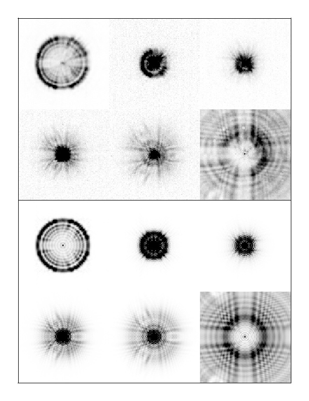

### The early days of the Hubble Space Telescope

My involvement with HST began when I was a graduate student at the
University of California, Santa Cruz. In 1985, after a couple of years of
classes, I was trying to develop a dissertation topic. I was super
fortunate that Sandy Faber reached out to me and suggested that 
I could work on developing some techniques for analyzing Hubble images,
which was just a couple of years away from launch at that time, and
then apply these to early HST data obtained by the WF/PC Investigation
Definition Team (IDT), of which Sandy was a member. 
I worked on developing routines for stellar photometry, which involved
simulating HST images and then adapting Peter Stetson's DAOPHOT program
to provide optimal results when analyzing them.

Unfortunately, working on early HST data for my dissertation was not to be, as the Challenger
disaster in 1987 deferred the original launch date. I went ahead and
did a split dissertation with the stellar photometry work combined with
totally unrelated calculations of matter power spectra and microwave
background anisotropies for a range of cosmological scenarios with different
combinations of baryons, cold dark matter, neutrinos, and radiation.

After graduating in 1989, I moved to Lowell Observatory, where WF/PC
IDT members Bill Baum and Deidre Hunter were located. I continued some
of my dissertation work and twidled my thumbs a bit before HST was
finally launched in April 1990.

Shortly after launch, I took up temporary residence in Bowie MD, as
the WF/PC IDT leased some office space at nearby Bowie State University,
conveniently located just a few miles from Goddard Space Flight Center.
Various members of the WF/PC IDT spent time there including Jeff Hester, 
Tod Lauer, Bob Light, Ed Groth, Earl O'Neil, Roger Lynds, Jim Westphal,
and Sandy.

After first light (May 20), several of us would regularly attend the daily 
briefings at GSFC, led by Joe Ryan. Early images didn't look especially 
sharp, but most assumed that this was due to a need for collimation/focus
adjustment using the secondary mirror. Roger Lynds, however, noted in
one of the daily meetings that the images looked like they had spherical
aberration. He was roundly chewed out (which Joe Ryan later apologized for!).

The initial plans for collimation were to use the wavefront sensors, not
imaging. These were mostly analyzed by the group for Hughes Danbury
Optical Systems (HDOS). I didn't understand the details but they were
having issues with getting their data to make sense and, after several
weeks, the project was getting frustrated with little apparent progress.

At this point, the project started to obtain more regular imaging data,
putting stars in various field locations in the WF/PC, and taking some
FOC data farther off axis. The engineers were reluctant to move the
secondary mirror by a large amount, as that would carry the risk that
the mirror might get stuck far from the expected best focus position.
All of the images showed a core-halo structure, with light spread over
a large area, and multiple "tendrils" in the outer regions.

At STScI, Chris Burrows was analyzing these images using a phase retrieval
technique, and was convinced that there was a significant amount of
aberration, including a large amount of spherical aberration. This was
of particular concern, as spherical aberration could not be corrected
with secondary mirror motions, and the range of the primary mirror
actuators was too small to be able to correct the amount of spherical
aberration that Chris was suggesting. Engineers and managers were not
immediately convinced, perhaps because the idea was so distressing, and
because it seemed to them indirect and not visually apparent. I
think they did not fully understand Chris' analysis and were hoping
that it somehow was not correct.

Things continued for a few weeks. Some of the astronomers suggested that
aberration diagnosis could be made by taking a wide "focus sweep", where
different aberrations have very different characters when looked at
through a range of different focal plane locations. Despite the reluctance
of the engineers, this was finally agreed upon. My recollection, which
may or may not be correct, was that in mid-June, the project asked the
WF/PC team for a recommendation. I was the one who happened to be at
GSFC at the time, and I said "let's do the coarse focus run", and they
did it. This coming from someone just a year out of graduate school
with little to no background in optics! It seemed a little crazy
to me at the time that more optics experts -- who certainly existed! -- 
weren't weighing in, but perhaps they were too reluctant to highlight
problems.

To assess the coarse focus run images, Sandy and I prepared a whole
bunch of simulated images, with various degrees of aberration. My recollection
is that we simulated focus runs with a range of different amounts of 
spherical aberration and different amounts of coma. We printed the
images, and laid them out in a grid on a large conference room table at Bowie
State, with increasing spherical aberration along one axis, and increasing
coma along the other. When the coarse focus run images came in, we printed
them out and just moved with that image around the table, looking for
a good match. We found a good one with 0.5 waves 
(at the observed 547nm wavelength of the images) of spherical aberration.

[{: style="float: left ; width: 30% ; padding: 15px"}](hstspher.jpg)

Visually, the coarse focus run was striking, with a clear lack
of a best focus and no symmetry running through the focus positions, a
clear signature of spherical aberration.  There was a tremendous
amount of structure in the images, with tendrils, spots, ripples, etc.
The simulations were able to reproduce these in great detail; they
arise from diffraction in a strongly aberrated system with a pupil
function that has a lot of structure; an HST central obscuration with
a four-legged spider of the HST secondary support and three
primary mirror support pads, plus a larger
WF/PC central obscuration with a three-legged spider that moved around
relative to the HST features depending on the location in the field
of view.

We prepared a mosaic of the coarse focus run images of a star, along with simulated
images with spherical aberation at corresponding focus positions. These
were shown to project management at a meeting at GSFC on July 25. I believe
that these were the final, absolutely convincing, evidence that convinced
management that there was a severe, uncorrectable problem, and put all
efforts to deny this at rest.

After that, things turned to trying to understand the impact of the aberration
on science, and to deconvolution techniques to try to recover higher
spatial resolution. 
An issue of the Astrophysical Journal letters was published in 1991
that included a paper by Burrows, Holtzman et al on [The Imaging Performance
of the Hubble Space Telescope](https://ui.adsabs.harvard.edu/abs/1991ApJ...369L..21B/abstract), 
along with several papers discussing
early science results.

A separate effort was also made to understand the source of the error,
culminating in the Allen commission report, which discovered an error
in the assembly of the reflective null corrector that was used to 
shape the primary mirror. The investigative effort also demonstrations
of multiple failures in management and reporting that led to the error
going unreported, although there was ample evidence that there was a
problem!

Of course, the story has a happy ending. HST was always intended to be
servicable, and in 1993, an aberrated WFPC2 was installed, where its aberration
exactly canceled the aberration in the optical telescope assembly. At the
same time, COSTAR was installed that put corrective optics in front  of
several of the other instruments. Subsequent instruments all included
corrective optics, and the diffraction limited performance of HST was
achieved!

On my part, things moved on. We did several science papers with the
aberrated WF/PC, including an exciting discovery of young globular
clusters in the galaxy NGC 1275 and some work on the stellar populations
of the Galactic bulge. I joined the Investigation Definition
Team of WFPC2 and, after its launch, characterized the performance and
photometric calibration of the instrument. This was
published in a pair of papers, [The Performance and Calibration of
WFPC2 on the Hubble Space Telescope](https://ui.adsabs.harvard.edu/abs/1995PASP..107..156H/abstract) and
[The Photometric Performance and Calibration of WFPC2](https://ui.adsabs.harvard.edu/abs/1995PASP..107.1065H/abstract). 

I was involved with stellar population work in nearby Local Group galaxies 
for several years, and generated a large archive of HST observations of
Local Group stellar populations. I was a member of the Science Oversight
Committee for the WFC3 that was installed into the HST in 2009.
