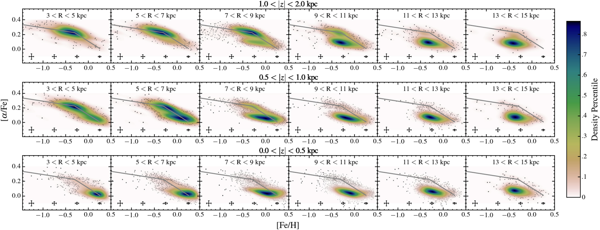
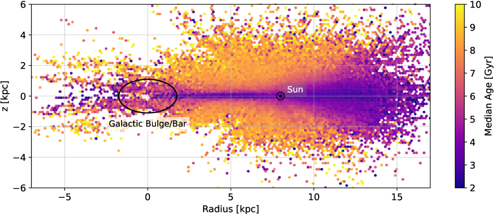
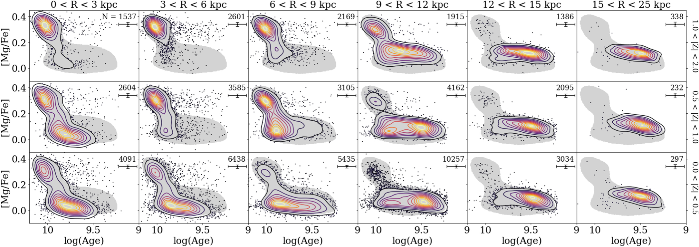
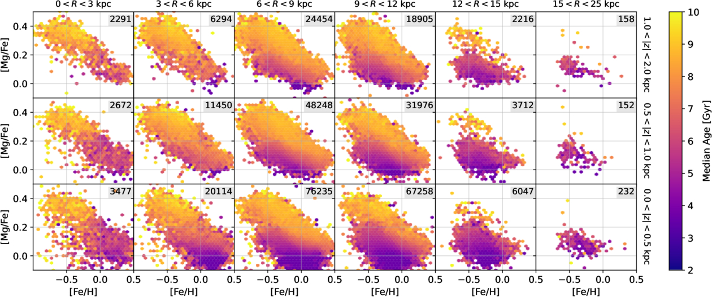
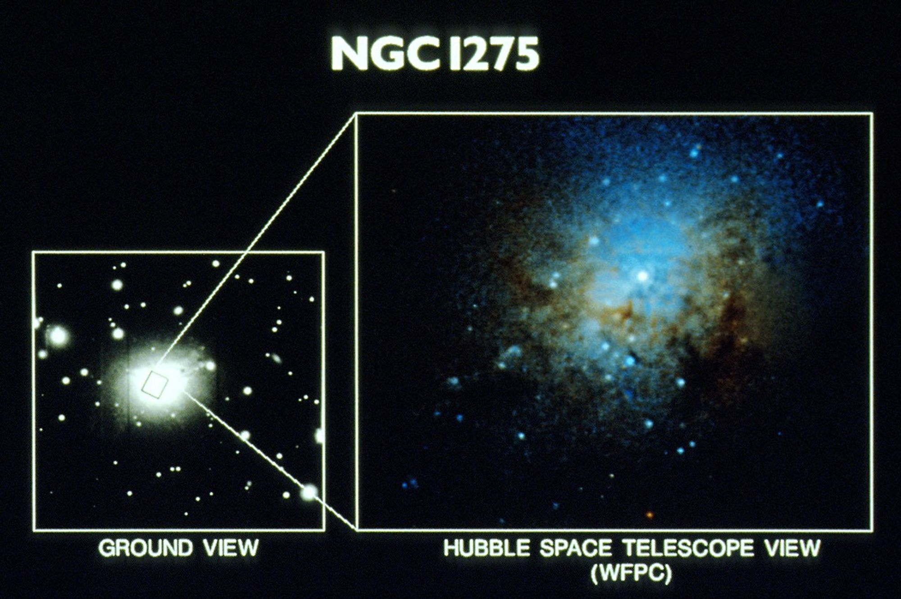

## Research

[ADS Search for refereed articles](https://ui.adsabs.harvard.edu/search/fq=%7B!type%3Daqp%20v%3D%24fq_database%7D&fq=%7B!type%3Daqp%20v%3D%24fq_property%7D&fq_database=database%3A%20astronomy&fq_property=property%3A%20refereed&q=author%3A(%22Holtzman%2C%20J%22)&sort=date%20desc%2C%20bibcode%20desc&p_=0)

### Sloan Digital Sky Survey

##### Milky Way stellar populations

[{: style="float: right ; width: 50% ; padding: 15px"}](apj515238f4_hr.jpg)
The Apache Point Observatory Galactic Evolution Experiment (APOGEE) of the Sloan Digital Sky Survey has provided dramatic new
views of Galactic stellar populations across the Milky Way, due to its ability to penetrate dust in the plane of the Galaxy using
infrared light. The moderate high resolution spectroscopy allows measurements of the abundances of multiple chemical elements.
Together, these enable **chemical cartography**.

Some of the initial results show how the so-called "alpha bimodality" varies across the disk of the Milky Way, as shown in this
pionering plot from [Hayden et al. 2015](https://ui.adsabs.harvard.edu/abs/2015ApJ...808..132H/abstract)

[{: style="float: left ; width: 50% ; padding: 15px"} ](ajaddd18f10_hr.jpg)
Subsequent work at NMSU has focussed on deriving ages of red giant stars observed with APOGEE. This is enabled by the ability of
APOGEE to measure carbon and nitrogen abundances; the C/N ratio varies with stellar mass due to variations in mixing and the amount 
of CNO burning, and masses of red giants directly imply ages. The figure to the left is a 
map of mean ages across the Milky Way from [Stone-Martinez et al. 2025]()

Maps of the [alpha/Fe] vs [Fe/H] relation encoded by stellar age from [Stone-Martinez et al 2025]() and 
[Imig et al 2023](https://ui.adsabs.harvard.edu/abs/2023ApJ...954..124I/abstract):
[{: style="float: left ; width: 40% ; padding: 15px"}](apjace9b8f25_hr.jpg)
[{: style="float: right ; width: 40% ; padding: 15px"}](ajaddd18f13_hr.jpg)

       

SDSS/APOGEE has provided data that factored into multiple Ph.D. dissertations of NMSU students advised
by me: Michael Hayden, Diane Feuillet, Sten Hasselquist, Drew Chojnowski, Julie Imig, and Alexander
Stone-Martinez.

##### Other SDSS projects

I've been involved in several aspects of the Sloan Digital Sky Survey:

- Many different science projects, see a [list of papers](https://ui.adsabs.harvard.edu/search/fq=%7B!type%3Daqp%20v%3D%24fq_database%7D&fq_database=database%3A%20astronomy&q=author%3A(%22Holtzman%22)%20abs%3A(Sloan)&sort=date%20desc%2C%20bibcode%20desc&p_=0)
- I was closely involved with the development of reduction and analysis software for the APOGEE project, which
obtained high resolution near-IR spectra of about 600,000 Milky Way stars. I served as the Survey Scientist for the SDSS-IV portion
of APOGEE. A description of many of the analysis techniques used can be found in the [SDSS DR17 data release paper](https://ui.adsabs.harvard.edu/abs/2022ApJS..259...35A/abstract), [Jonsson et al. (2020)](https://ui.adsabs.harvard.edu/abs/2020AJ....160..120J/abstract) and 
[Holtzman et al (2018)](https://ui.adsabs.harvard.edu/abs/2018AJ....156..125H/abstract)
- the SDSS-II supernova survey that was conducted 2005-2007; I
developed techniques for the consistent measurement of SN brightnesses
against arbiratry galaxy backgrounds using data obtained from different telescopes
([Holtzman et al. (2008)](https://ui.adsabs.harvard.edu/abs/2008AJ....136.2306H/abstract)

### Stellar populations in the Local Group

##### Star formation histories of Local Group galaxies

One of my primary interests has been in studying stellar populations in
the Local Group through photometry of individual stars. Much of
this work was done using the Hubble Space Telescope. Several papers
discussed the star formation history of the LMC ([Holtzman et al. 1997](https://ui.adsabs.harvard.edu/abs/1997AJ....113..656H/abstract),
[Geha et al. 1998](https://ui.adsabs.harvard.edu/abs/1998AJ....115.1045G/abstract),
[Holtzman et al. 1999](https://ui.adsabs.harvard.edu/abs/1999AJ....118.2262H/abstract), 
and another in Phoenix ([Holtzman et al. 2000](https://ui.adsabs.harvard.edu/abs/2000AJ....120.3060H/abstract).

Several other papers discussed stellar populations in the Galactic
bulge ([Holtzman et al 1993](https://ui.adsabs.harvard.edu/abs/1993AJ....106.1826H/abstract), 
[Holtzman et al 1998](https://ui.adsabs.harvard.edu/abs/1998AJ....115.1946H/abstract)).
These suggested a non-neglible contribution of intermediate age stars in the
Bulge, although most were not convinced at the time.

A large <a
href="http://astronomy.nmsu.edu/logphot"> stellar photometry archive </a>
was constructed from all photometry done by the WFPC2 in the
Local Group [(Holtzman, Afonso, & Dolphin 2006)](https://ui.adsabs.harvard.edu/abs/2006ApJS..166..534H/abstract).
[Weisz et al. (2014)](https://ui.adsabs.harvard.edu/abs/2014ApJ...789..147W/abstract)
(also [Weisz et al (2014b)](https://ui.adsabs.harvard.edu/abs/2014ApJ...789..148W/abstract) and
[Weisz et al (2014c)](https://ui.adsabs.harvard.edu/abs/2014ApJ...789..148W/abstract))
used this to derive star formation histories of Local Group galaxies.

##### Metallicity distribution functions in Local Group dwarfs

[Ross et al (2015)](https://ui.adsabs.harvard.edu/abs/2015AJ....149..198R/abstract)
used HST photometry through a set of metallicity-sensitive filters to
derive metallicity distribution functions in the  Leo I, Leo II, IC 1613, and Phoenix
local group dwarfs.

###  External galaxies

I am interested in structural properties of galaxies, in particular
disk galaxies and the nature of bulges, e.g.  [Moorthy et al
2006](https://ui.adsabs.harvard.edu/abs/2006MNRAS.371..583M/abstract), 
[Courteau et al
2007](https://ui.adsabs.harvard.edu/abs/2007ApJ...655L..21C/abstract).
I've been involved in both photometric and spectroscopic studies.
I've also studied properties of galaxies as a function of their
environment ([Patiri et al
2006](https://ui.adsabs.harvard.edu/abs/2006MNRAS.372.1710P/abstract)).

I was involved in a survey of galaxies in the Virgo cluster with
my friend, colleague, and fellow UCSC student Stephane Courteau
([Ouellette et al 2017](https://ui.adsabs.harvard.edu/abs/2017ApJ...843...74O/abstract),
[Ouellette et al 2022](https://ui.adsabs.harvard.edu/abs/2022MNRAS.514.2356O/abstract)).

### HST/WFPC2 performance and calibration

As a member of the Investigation Definition Team of WFPC2, I
characterized the performance and photometric calibration of the
instrument. This was published in a pair of papers, [The Performance
and Calibration of WFPC2 on the Hubble Space
Telescope](https://ui.adsabs.harvard.edu/abs/1995PASP..107..156H/abstract)
and [The Photometric Performance and Calibration of
WFPC2](https://ui.adsabs.harvard.edu/abs/1995PASP..107.1065H/abstract).
The latter has my highest citation count as a first-author paper!

### Star clusters

{: style="float: left ; width: 30% ; padding: 15px"}
 A separate research interest is in the properties of
young, compact, massive star clusters. This was motivated by our initial
discovery of a population of bright blue clusters in NGC 1275 
([Holtzman et al. 1992](https://ui.adsabs.harvard.edu/abs/1992AJ....103..691H/abstract)
that helped
to spark the development of this field. The initial observations were made
with the Hubble Space Telescope WF/PC, even with its aberrated images.

[NASA article from 1992](https://science.nasa.gov/missions/hubble/nasas-hubble-space-telescope-discovers-young-star-clusters-in-giant-galaxy/)

Subsequent work with WFPC2 extended observations to other galaxies  ([Holtzman
et al 1996](https://ui.adsabs.harvard.edu/abs/1996AJ....112..416H/abstract),
[Carlson et al 1998](https://ui.adsabs.harvard.edu/abs/1998AJ....115.1778C/abstract),
[Carlson et al 1999](https://ui.adsabs.harvard.edu/abs/1999AJ....117.1700C/abstract))
and to measuring sizes of the young clusters ([Carlson et al 2000](https://ui.adsabs.harvard.edu/abs/2001PASP..113.1522C/abstract)).

    

### Cosmology

 For my dissertation, I did cosmological calculations using linear
perturbation theory to calculate observational predictions for large scale
structure and cosmic microwave background anisotropies ([Holtzman 1989](https://ui.adsabs.harvard.edu/abs/1989ApJS...71....1H/abstract)).
These calculations were used to interpret cosmic microwave background observations from COBE, but were soon superceded by much
faster calculators.  Subsequent papers focussed  on models with a mix of cold and hot dark matter ().
I still maintain a strong interest in understanding the interplay between cosmology and
the formation and evolution of galaxies.

During SDSS-II, I worked with the SDSS Supernova Survey team, in particular,
to develop a technique for measuring the light curves of the supernovae; the
technique and light curves are published in
[Holtzman et al. 2008](https://ui.adsabs.harvard.edu/abs/2008AJ....136.2306H/abstract).
